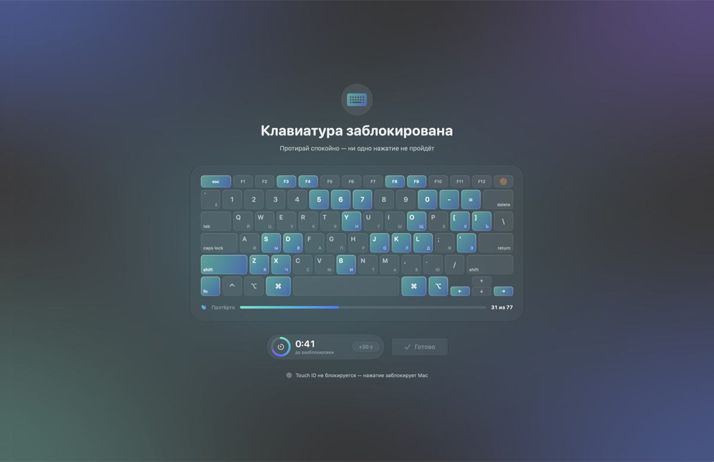
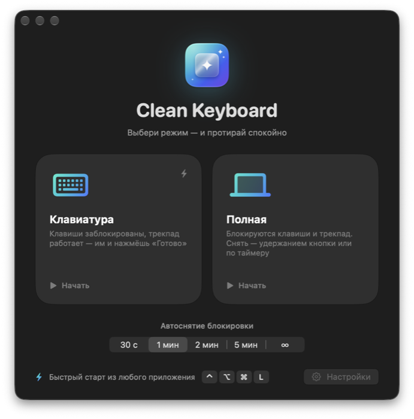

<p align="center">
  
</p>

<h1 align="center">Clean Keyboard</h1>

<p align="center">
  Блокирует клавиатуру MacBook, пока ты её протираешь. Ни одной случайной буквы.<br>
  <sub>Locks your MacBook keyboard (and optionally trackpad) while you clean it. macOS 26+, UI in Russian.</sub>
</p>

<p align="center">
  
</p>

## Возможности

- **Два режима.** «Клавиатура» — клавиши заблокированы, трекпад работает. «Полная» — блокируется и трекпад, снять можно удержанием кнопки «Готово» или по таймеру.
- **Блокирует всё**, что можно заблокировать программно: буквы, F-ряд (яркость, громкость, медиа), модификаторы, Fn/🌐, Caps Lock (его состояние восстанавливается после разблокировки).
- **Карта клавиш.** Нажатая клавиша вспыхивает и остаётся подсвеченной — видно, что уже протёрто.
- **Таймер автоснятия** (30 с – 5 мин или без таймера), но не дольше 10 минут в любом случае.
- **Безопасно.** Если Mac уснёт или экран заблокируется, блокировка снимается. Если приложение упадёт — клавиатура сразу заработает.
- **Быстрый старт** горячей клавишей <kbd>⌃</kbd><kbd>⌥</kbd><kbd>⌘</kbd><kbd>L</kbd> из любого приложения.
- Значок в Dock и в строке меню, дизайн на Liquid Glass.

<p align="center">
  
</p>

## Установка

1. Скачай `Clean-Keyboard.dmg` из [последнего релиза](../../releases/latest) и перетащи приложение в «Программы».
2. Приложение не подписано сертификатом Apple, поэтому при первом запуске macOS его заблокирует. Открой **Системные настройки → Конфиденциальность и безопасность**, пролистай вниз и нажми **«Всё равно открыть»**.
3. Выдай доступ в **«Универсальном доступе»** — без него macOS не позволит перехватывать нажатия. Приложение ничего не записывает и никуда не отправляет, исходный код открыт.

Требования: macOS 26 или новее, Mac с Apple Silicon.

## Что заблокировать нельзя

- **Touch ID / кнопка питания** обрабатываются аппаратно — нажатие заблокирует Mac (Clean Keyboard при этом сам снимет блокировку).
- Если в фокусе **поле пароля** (Secure Input), macOS может пропустить часть нажатий — приложение предупредит об этом.

## Сборка из исходников

Нужны Xcode 26+ и [XcodeGen](https://github.com/yonaskolb/XcodeGen) (`brew install xcodegen`).

```sh
xcodegen generate
open CleanKeyboard.xcodeproj
```

В **Signing & Capabilities → Team** выбери свой Apple ID, иначе macOS будет сбрасывать разрешение «Универсальный доступ» после каждой пересборки. Чтобы команда сохранялась, впиши Team ID в `DEVELOPMENT_TEAM` в `project.yml`.

Иконка генерируется скриптом `swift Scripts/make-icon.swift`.

Debug-сборка называется «Clean Keyboard Dev» и умеет показывать экраны без реальной блокировки:

```sh
"build/Build/Products/Debug/Clean Keyboard Dev.app/Contents/MacOS/Clean Keyboard Dev" -PreviewOverlay keyboard
# keyboard | full | countdown | finished | main | settings | onboarding
```

### Как устроено

| Файл | Что делает |
|---|---|
| `Core/EventBlocker.swift` | `CGEventTap` на уровне HID на отдельном потоке: съедает клавиши и медиа-клавиши, в полном режиме — клики, скролл и жесты (кроме кнопки «Готово») |
| `Core/LockController.swift` | Сеанс: отсчёт → блокировка → «Чисто!», таймер, авто-снятие при сне и блокировке экрана |
| `Core/SystemGuards.swift` | Восстановление Caps Lock, экран не гаснет, проверка Secure Input |
| `UI/Overlay/` | Полноэкранный оверлей с картой клавиш |

## Лицензия

[MIT](LICENSE)
